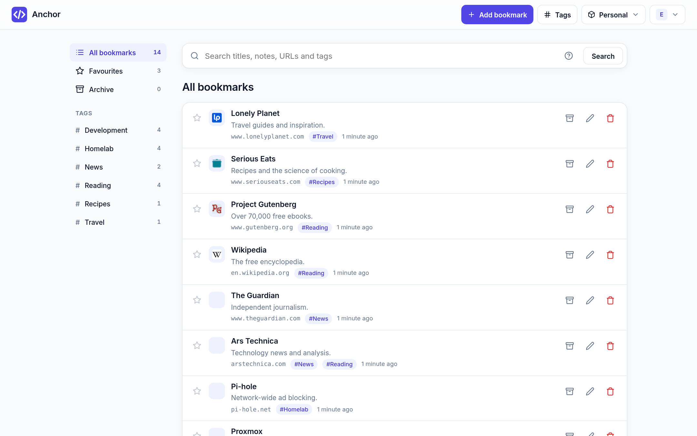
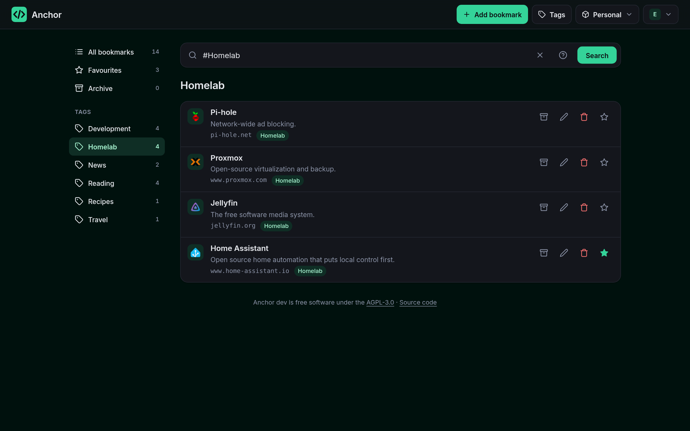
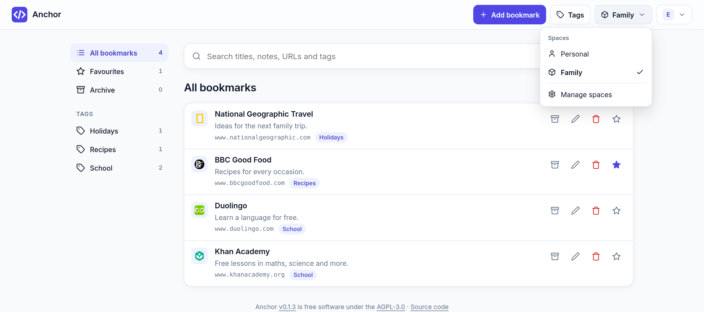
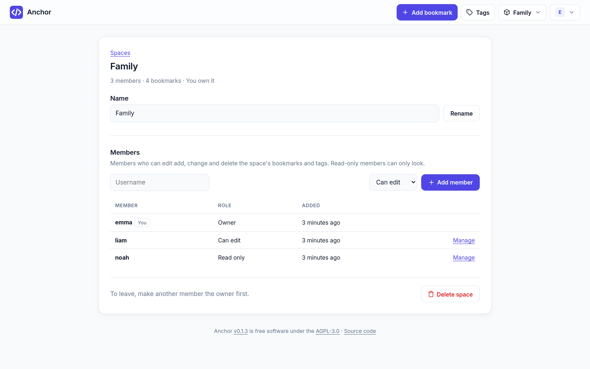
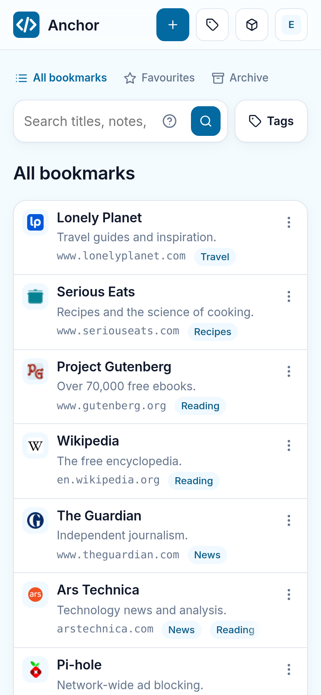

  

<h1 align="center">Anchor</h1>

  A self-hosted bookmark manager for you, your family or your team. 
  Save links, tag them, find them again in seconds, and keep the whole collection on your own server.

  

## Features

**Bookmarks**
- Save a link from the add form, the bookmarklet or the REST API; Anchor fills in the page's title, description and icon.
- Mark favourites, archive what you're done with, and add your own notes.
- Each URL is saved once: saving it again opens the bookmark you already have.

**Tags and search**
- Tags with spaces in their names, managed in one place: create, rename, merge and delete.
- Full-text search over titles, descriptions, notes, URLs and tags, with filters for tags, sites, dates, favourites and shared links.
- Bundles: save a search and it stays in the sidebar, always up to date.

  

**Spaces**
- A personal space for your own bookmarks, and shared spaces for your family or team, each with its own bookmarks and tags.
- Members can edit or only read; the owner manages who's in, and switching spaces is one click in the top bar.

  

  

**Sharing**
- Give a single bookmark a public read-only link, and take it back whenever you like.

**Import and export**
- Import from any browser, linkding, Pocket and Pinboard, keeping folders as tags.
- Export everything as browser bookmarks or as JSON, at any time.

**Accounts and security**
- Multiple users, each with a private personal space.
- Two-factor authentication with an authenticator app, passkeys or recovery codes.
- Personal API tokens, read-only or read & write.
- For admins: user management, invite links, open/invite/closed signup and a policy that requires 2FA.

**Look and feel**
- Light and dark themes, a choice of accent colours and fonts, and the sidebar on either side.
- In English, Dutch, Spanish and French: Anchor follows your browser's language, or the one you pick.
- Works on phones as well as desktops.

  

## Documentation

- [Deployment](docs/deployment.md): running Anchor, configuration, backups and upgrades.
- [How Anchor works](docs/how-it-works.md): bookmarks, search, page details, import and export, and security.
- [REST API](docs/api.md): endpoints and authentication.

## License

Anchor is free software under the [GNU Affero General Public License v3.0](LICENSE). You may use, change and share it; if you run a changed version as a network service, you must offer its users the source of your version.

It builds on permissively licensed Go modules (MIT, BSD, Apache-2.0), the [Lucide](https://lucide.dev) icons (ISC) and the [Inter](https://rsms.me/inter/) font (SIL Open Font License, `internal/web/static/fonts/Inter-OFL.txt`). The Docker image carries Anchor's license and those of the modules compiled into it in `/licenses`.
